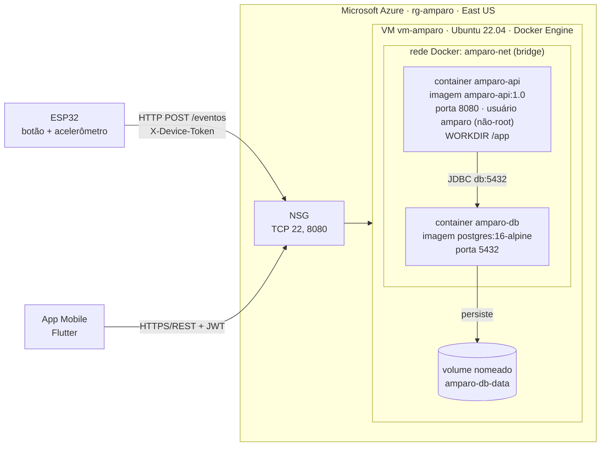

# Amparo · Infraestrutura em nuvem (Docker + Azure)

**Global Solution 2026/2 · CitizenTech · FIAP · DevOps Tools & Cloud Computing**

API Amparo (Java/Spring Boot) e banco PostgreSQL rodando em **dois containers integrados** via
Docker Compose, em uma **VM Ubuntu no Microsoft Azure** provisionada por Azure CLI.

## Integrantes

| Nome | RM | Turma |
|------|----|-------|
| Matheus Carneiro Maciel | 567753 | 2TDSPB |
| Murilo Marques Cabral | 568224 | 2TDSPB |
| Paulo Henrique da Silva Kian | 563343 | 2TDSPB |

## Links

- 🎥 Vídeo de demonstração: **[preencher — YouTube não listado]**
- 🌐 API em produção: http://168.62.161.251:8080/swagger-ui.html *(VM ligada durante o período de avaliação)*
- API (código-fonte original): https://github.com/kakarneiro/amparo-api
- Dispositivo IoT: https://github.com/kakarneiro/amparo-iot

---

## 1. A solução

Rede de cuidado para idosos e PcD: um dispositivo ESP32 (botão de emergência + acelerômetro)
envia eventos para a API, que aciona os cuidadores em ordem de prioridade; o app Mobile dos
familiares consome a mesma API. Esta entrega coloca a API e o banco em nuvem, de forma
reproduzível.

## 2. Arquitetura macro



| Elemento | Detalhe |
|----------|---------|
| VM | `vm-amparo`, Ubuntu 22.04, `Standard_D2as_v4`, East US, IP público `168.62.161.251`, criada por `scripts/azure-vm.sh` |
| Container **api** | Build multi-stage (Maven → JRE 21 Alpine), usuário `amparo` não-root, `WORKDIR /app`, variáveis de ambiente para banco/JWT/token, `EXPOSE 8080` |
| Container **db** | `postgres:16-alpine`, volume nomeado `amparo-db-data`, variáveis `POSTGRES_*`, porta 5432, healthcheck `pg_isready` |
| Rede | `amparo-net` (bridge): a API alcança o banco pelo nome do serviço `db` |
| Dependência | `api` só sobe depois que `db` passa no healthcheck |
| Tabelas | 7 tabelas relacionadas criadas pelo Hibernate (`tb_cidadao`, `tb_cuidador`, `tb_dispositivo`, `tb_evento`, `tb_atendimento`, `tb_lembrete`, `tb_usuario`) |

## 3. Estrutura do repositório

```
amparo-devops/
├── docker-compose.yml       # api + db, network, volume, portas, env, depends_on
├── .env.example             # variáveis (copiar para .env)
├── amparo-api/              # código-fonte da API
│   ├── Dockerfile           # multi-stage, non-root, WORKDIR, ENV, EXPOSE
│   ├── .dockerignore
│   └── src/ ...
├── scripts/
│   ├── azure-vm.sh          # Azure CLI: grupo de recursos, VM, NSG, IP
│   ├── setup-vm.sh          # na VM: instala Docker, clona, sobe o compose
│   └── evidencias.sh        # gera todas as evidências em sequência
└── docs/                    # prints e evidências
```

---

## 4. How-To: reproduzir do zero

### 4.1 Provisionar a VM (Azure CLI)

No [Azure Cloud Shell](https://shell.azure.com) (Bash) ou com `az login` local:

```bash
git clone https://github.com/kakarneiro/amparo-devops.git
cd amparo-devops
bash scripts/azure-vm.sh
```

O script executa, nesta ordem:

```bash
az group create --name rg-amparo --location eastus
az network public-ip create --resource-group rg-amparo --name vm-amparo-ip --sku Standard --allocation-method Static
az vm create --resource-group rg-amparo --name vm-amparo --image Ubuntu2204 --size Standard_D2as_v4 \
             --admin-username azureuser --generate-ssh-keys --public-ip-address vm-amparo-ip
az vm open-port --resource-group rg-amparo --name vm-amparo --port 8080 --priority 1010
az network public-ip show --resource-group rg-amparo --name vm-amparo-ip --query ipAddress -o tsv
```

> Por que East US e `Standard_D2as_v4`: na assinatura Azure for Students a série B retornou
> `SkuNotAvailable` tanto em Brazil South quanto em East US; a série D estava liberada.
> O IP público é criado antes da VM para evitar o erro `publicIPAddresses ... not found`.

Anote o **IP público** impresso no final.

### 4.2 Preparar a VM e subir os containers

```bash
ssh azureuser@<IP_PUBLICO>
curl -fsSL https://raw.githubusercontent.com/kakarneiro/amparo-devops/main/scripts/setup-vm.sh | bash
```

O `setup-vm.sh` instala Docker Engine + Compose plugin, clona este repositório, cria o `.env`
a partir do `.env.example` e executa `docker compose up -d --build`.

Em ~3 minutos (build do Maven) a API responde em `http://<IP_PUBLICO>:8080/swagger-ui.html`.

### 4.3 Rodar na sua máquina (opcional)

Com Docker Desktop instalado:

```bash
git clone https://github.com/kakarneiro/amparo-devops.git
cd amparo-devops
cp .env.example .env
docker compose up -d --build
```

Swagger em `http://localhost:8080/swagger-ui.html`.

---

## 5. Como testar o CRUD

Usuários de demonstração (criados pelo `DataLoader` no primeiro start, perfil `docker`):

| Papel | E-mail | Senha |
|-------|--------|-------|
| ADMIN | `admin@amparo.com` | `admin123` |
| CUIDADOR | `ana@amparo.com` | `ana123` |

Pelo Swagger (`/swagger-ui.html` → Authorize com o token de `POST /auth/login`):

1. `POST /cidadaos` → 201
2. `GET /cidadaos` → lista paginada
3. `PUT /cidadaos/{id}` → 200
4. `DELETE /cidadaos/{id}` → 204
5. `POST /eventos` com header `X-Device-Token: esp32-amparo-dev-token` → 201, cuidadora acionada

Ou tudo de uma vez, na VM:

```bash
bash scripts/evidencias.sh
```

---

## 6. Evidências

Comandos usados (saída em `docs/evidencias.txt` e prints em `docs/`):

| Evidência | Comando |
|-----------|---------|
| Containers executando | `docker compose ps` |
| Logs | `docker compose logs -f api` / `docker compose logs db` |
| Acesso ao container | `docker compose exec api sh` |
| Usuário não-root | `docker compose exec api whoami` → `amparo` |
| WORKDIR / estrutura | `docker compose exec api sh -c 'pwd && ls -la'` → `/app`, `app.jar` |
| Variáveis de ambiente | `docker compose exec api env` |
| Volume nomeado | `docker volume inspect amparo-db-data` |
| CRUD | Swagger ou `scripts/evidencias.sh` |
| Persistência | `docker compose down && docker compose up -d` → dados continuam |
| SELECT no banco | `docker compose exec db psql -U amparo -d amparo -c 'SELECT * FROM tb_cidadao;'` |

### Prints

| | |
|--|--|
|  VM no portal Azure |  `docker compose ps` |
|  logs dos containers |  usuário não-root e WORKDIR |
|  Swagger na VM (IP público) |  SELECT no PostgreSQL |

*(adicionar os prints em `docs/` com esses nomes)*

---

## 7. Decisões técnicas

- **PostgreSQL** em vez de Oracle no container: imagem oficial leve (`alpine`), sobe em segundos,
  e a API usa JPA, então nada muda no código.
- **Build multi-stage**: a imagem final não tem Maven nem código-fonte, só o JRE e o jar
  (~200 MB em vez de ~700 MB).
- **Usuário não-root + `restart: unless-stopped`**: a API não roda como root e volta sozinha se
  a VM reiniciar.
- **`depends_on` com `condition: service_healthy`**: evita a API falhar na primeira conexão
  antes do Postgres aceitar conexões.
- **Perfil `docker`** da API: ativa a carga inicial de demonstração só no primeiro start
  (idempotente), o que permite demonstrar login e CRUD sem passos manuais.
- **Segredos via `.env`** (não versionado): JWT, senha do banco e token do dispositivo ficam
  fora do repositório; o `.env.example` documenta o formato.

## 8. Encerrar o ambiente (evitar custo)

```bash
az group delete --name rg-amparo --yes --no-wait
```

## Uso de IA generativa

Utilizamos o Claude (Anthropic) para estruturar o Dockerfile, o Compose e os scripts de Azure CLI
e revisar este README. Toda a infraestrutura foi executada e validada pela equipe.
