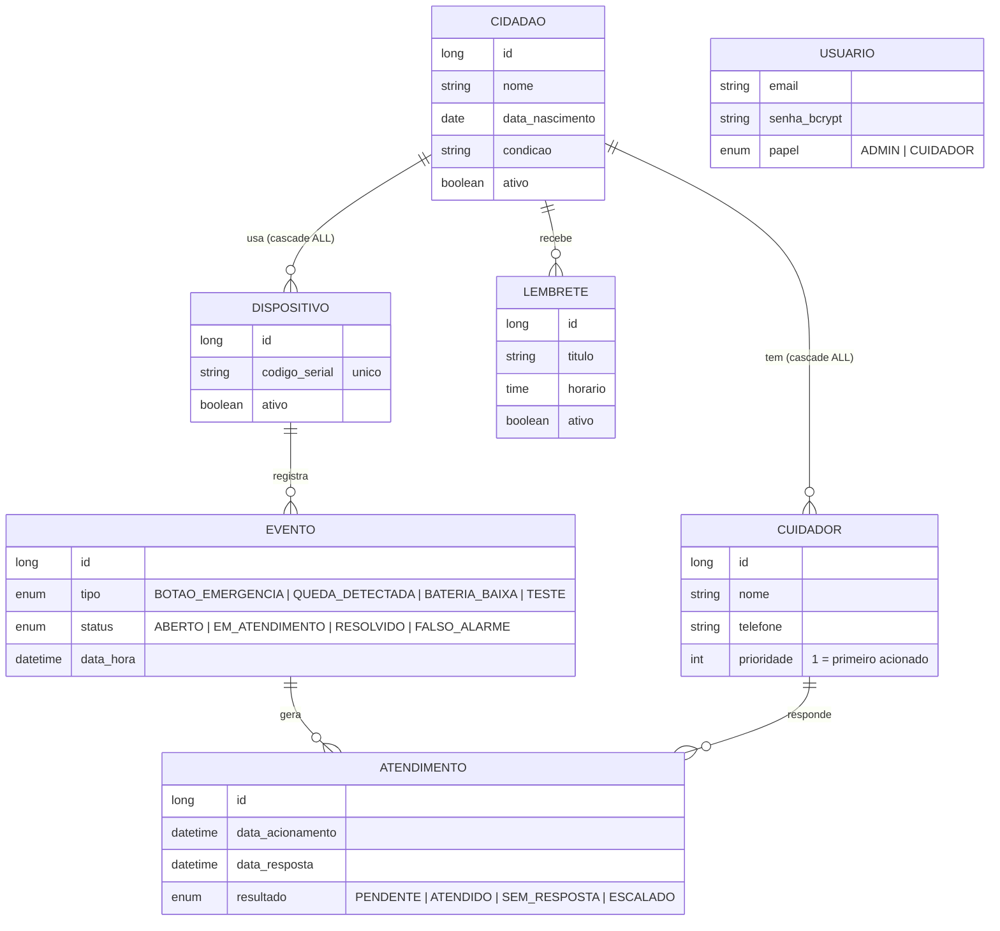

# Amparo API

**Global Solution 2026/2 · CitizenTech · FIAP · Java Advanced**

Rede de cuidado para idosos e pessoas com deficiência que vivem sozinhos. Um dispositivo IoT
(ESP32 com botão de emergência e acelerômetro) registra eventos nesta API, que **aciona os
cuidadores cadastrados em ordem de prioridade** (filha → vizinho → serviço de emergência) e
expõe tudo para o aplicativo Mobile usado pelas famílias.

- **Cidadão beneficiado:** idosos e PcD que moram sozinhos, e seus familiares/cuidadores.
- **ODS:** 3 (Saúde e bem-estar) e 10 (Redução das desigualdades).
- **Problema:** queda é a principal causa de internação de idosos no Brasil; quem mora sozinho
  pode ficar horas sem conseguir pedir ajuda.

## Integrantes

| Nome | RM | Turma |
|------|----|-------|
| Matheus Carneiro Maciel | 567753 | 2TDSPB |
| _preencher_ | _RM_ | _turma_ |
| _preencher_ | _RM_ | _turma_ |

## Vídeo pitch

🎥 **[Link do pitch no YouTube — preencher]**

## Relação com as outras entregas

| Disciplina | Como se conecta |
|-----------|-----------------|
| Mobile (Flutter) | O app consome esta API (login JWT, lista de cidadãos, eventos, cuidadores, lembretes). CORS liberado. |
| IoT (ESP32) | O dispositivo faz `POST /eventos` com o header `X-Device-Token`; a API aciona o cuidador automaticamente. |
| DevOps | Esta API roda em container (Dockerfile + docker-compose com PostgreSQL) em VM Azure. |
| Banco de Dados | Mesmo modelo de domínio implementado em Oracle PL/SQL (regras de escalonamento). |
| Compliance | Arquitetura TOGAF/ArchiMate documenta esta API na camada de Aplicação. |

---

## Como rodar

### Pré-requisitos
- Java 17+ (testado com 21)
- Maven 3.9+ (ou o wrapper da IDE)

### Perfil `dev` (recomendado para avaliação — H2 em memória, zero configuração)

```bash
mvn spring-boot:run -Dspring-boot.run.profiles=dev
```

Ou, no IntelliJ, crie uma configuração *Application* com a VM option `-Dspring.profiles.active=dev`.

Sobe em `http://localhost:8080` já com dados de exemplo e usuários de teste (`DataLoader`, perfis `dev` e `docker`).

- Swagger UI: **http://localhost:8080/swagger-ui.html**
- Console H2: `http://localhost:8080/h2` (JDBC URL `jdbc:h2:mem:amparo`, usuário `sa`, sem senha)
- Actuator: `/actuator/health`, `/actuator/info`, `/actuator/metrics`

### Perfil padrão (PostgreSQL)

Defina as variáveis de ambiente e rode sem perfil:

| Variável | Padrão | Descrição |
|----------|--------|-----------|
| `DB_URL` | `jdbc:postgresql://localhost:5432/amparo` | URL JDBC |
| `DB_USER` / `DB_PASSWORD` | `amparo` / `amparo` | Credenciais |
| `JWT_SECRET` | chave de desenvolvimento | Segredo HMAC do JWT (mín. 32 caracteres) |
| `JWT_EXPIRATION_MS` | `86400000` (24h) | Validade do token |
| `DEVICE_TOKEN` | `esp32-amparo-dev-token` | Token fixo do ESP32 |
| `CORS_ORIGINS` | `*` | Origens permitidas |
| `SERVER_PORT` | `8080` | Porta |

Nenhuma senha real está versionada: todos os valores sensíveis vêm de variável de ambiente.

---

## Usuários de teste (perfil `dev`)

| Papel | E-mail | Senha | Pode |
|-------|--------|-------|------|
| `ADMIN` | `admin@amparo.com` | `admin123` | Tudo: cadastros, exclusões, operação de eventos |
| `CUIDADOR` | `ana@amparo.com` | `ana123` | Ler tudo, responder atendimentos, escalar e encerrar eventos |

Dispositivos de teste: serial `ESP32-0001` (Maria das Dores) e `ESP32-0002` (José Carlos Lima),
token `esp32-amparo-dev-token`.

### Como testar

1. Abra o Swagger, clique em **Authorize**, faça `POST /auth/login` com o admin e cole o token em `bearerAuth`; em `deviceToken` cole `esp32-amparo-dev-token`.
2. `POST /eventos` com `{"codigoSerial":"ESP32-0001","tipo":"BOTAO_EMERGENCIA"}` → o evento nasce `EM_ATENDIMENTO` e a Ana Paula (prioridade 1) é acionada automaticamente.
3. `GET /eventos/1/atendimentos` → Ana `PENDENTE`.
4. `POST /eventos/1/escalar` → Ana vira `SEM_RESPOSTA`, Seu Roberto (prioridade 2) é acionado.
5. `PATCH /eventos/1/status` com `{"status":"RESOLVIDO"}` → o evento fecha e os links `escalar`/`alterar-status` somem do HATEOAS.

O arquivo `requests.http` na raiz tem todas as requisições na ordem (IntelliJ Ultimate ou extensão REST Client do VS Code).

---

## Modelo de domínio



### Decisões de modelagem

- **Todos os `@ManyToOne` são `LAZY`** — o lado "muitos" nunca carrega o pai sem necessidade; a
  conversão para DTO acontece dentro da transação do service, onde o acesso é seguro.
- **`Cidadao` tem `@OneToMany` com `cascade = ALL` e `orphanRemoval = true`** para cuidadores e
  dispositivos: eles não existem sem o cidadão, então excluir o cidadão limpa tudo.
- **`Evento` → `Dispositivo` → `Cidadao`**: o evento não aponta direto para o cidadão. O ESP32
  conhece apenas o próprio serial, então a API resolve o cidadão pelo dispositivo.
- **`Atendimento`** é a tabela de ligação entre `Evento` e `Cuidador`, com dados próprios
  (quando acionou, quando respondeu, resultado). É o que torna o escalonamento auditável.
- **DTOs (`records`) em todas as rotas**: a entidade nunca sai do service, evitando expor senha,
  relacionamentos bidirecionais e `LazyInitializationException`.

---

## Regras de negócio

| Regra | Onde |
|-------|------|
| Evento de emergência (`BOTAO_EMERGENCIA`, `QUEDA_DETECTADA`) aciona automaticamente o cuidador de prioridade 1 e marca o evento `EM_ATENDIMENTO`. `TESTE` e `BATERIA_BAIXA` não acionam ninguém. | `EventoService.registrar` |
| Dispositivo inativo não registra evento (422). | `EventoService.registrar` |
| Escalar: o atendimento pendente vira `SEM_RESPOSTA` e o próximo cuidador da cadeia é acionado. Cadeia esgotada → evento volta para `ABERTO` (central). | `EventoService.escalar` |
| Evento encerrado (`RESOLVIDO`/`FALSO_ALARME`) não pode ser escalado (422). | `EventoService.escalar` |
| Quando o cuidador responde (qualquer resultado ≠ `PENDENTE`), `dataResposta` é preenchida. | `AtendimentoService` |
| E-mail de usuário é único; senha sempre BCrypt. | `AuthService.registrar` |

---

## Consultas — o que foi usado e por quê

| Tipo | Onde | Por que esse tipo |
|------|------|-------------------|
| **Query method derivado** | `CuidadorRepository.findByCidadaoIdOrderByPrioridadeAsc` | Filtro + ordenação simples em uma tabela: o nome do método já documenta a regra (cadeia por prioridade). |
| **Query method derivado** | `CidadaoRepository.findByNomeContainingIgnoreCase`, `LembreteRepository.findByCidadaoIdAndAtivoTrueOrderByHorarioAsc`, `AtendimentoRepository.findFirstByEventoIdAndResultado` | Mesmo motivo: condições diretas, sem join. |
| **`@Query` JPQL** | `EventoRepository.buscarPorCidadao` | O cidadão está **dois níveis acima** (`Evento → Dispositivo → Cidadao`); um método derivado ficaria ilegível (`findByDispositivoCidadaoIdOrderBy...`) e o JPQL deixa o join explícito. |
| **`@Query` JPQL** | `EventoRepository.contarPorCidadaoEStatus` | Agregação (`count`) com caminho de associação; mais claro em JPQL. |
| **Specification** | `GET /cidadaos?nome=&condicao=&ativo=` e `GET /eventos?status=&tipo=&cidadaoId=&inicio=&fim=` | Filtros **opcionais e combináveis**: o app monta a tela de busca com qualquer combinação. Com query methods seriam 2ⁿ métodos; a Specification só põe no `WHERE` o que foi informado. |

Todas as listagens são paginadas e ordenáveis (`?page=&size=&sort=campo,asc`).

---

## Cache — o que foi cacheado e por quê

| Cache | Chave | Por que | Invalidação |
|-------|-------|---------|-------------|
| `cidadaos` | id do cidadão | O app abre a tela do cidadão a cada notificação; o cadastro muda raramente. | `PUT`/`DELETE` do cidadão (`@CacheEvict` por id). |
| `cuidadoresPorCidadao` | id do cidadão | A **cadeia de acionamento** é lida a cada emergência e precisa responder em milissegundos. | Qualquer `POST`/`PUT`/`DELETE` de cuidador e exclusão do cidadão. |
| `lembretesPorCidadao` | id do cidadão | A home do app lista os lembretes ativos a cada abertura. | Qualquer escrita em lembrete e exclusão do cidadão. |

**O que não foi cacheado, de propósito:** eventos e atendimentos. São o dado mais volátil do
sistema (mudam a cada acionamento) e uma leitura desatualizada aqui seria um risco real para
o cidadão.

Implementação: `@EnableCaching` + `ConcurrentMapCacheManager` (em memória). Trocar por Redis é
só configuração, sem mudar código.

---

## Segurança

- **JWT** (HS512, `jjwt`): `POST /auth/login` → `AuthenticationManager` valida e-mail/senha
  (BCrypt) → token com `sub` = e-mail e claim `papel`, validade 24h.
- **`JwtAuthFilter`**: em cada requisição lê `Authorization: Bearer`, valida e coloca o usuário no
  `SecurityContext`. API stateless (sem sessão, sem CSRF).
- **Papéis** (`SecurityConfig`):

  | Operação | ADMIN | CUIDADOR |
  |----------|:-----:|:--------:|
  | Leitura (`GET`) | ✔ | ✔ |
  | Cadastrar/editar cidadão, cuidador, dispositivo, lembrete | ✔ | ✖ (403) |
  | Excluir qualquer coisa | ✔ | ✖ (403) |
  | Escalar, alterar status, responder atendimento | ✔ | ✔ |

- **Dispositivo**: `POST /eventos` não usa JWT (o ESP32 não faz login). Passa pelo
  `DeviceTokenFilter`, que exige o header `X-Device-Token`.
- **CORS** configurado para o app Mobile (`CORS_ORIGINS`), com `Authorization` e `X-Device-Token`
  liberados.
- Erros de segurança respondem no mesmo formato `ApiError` do resto da API (401/403).

---

## Endpoints

| Recurso | Rotas |
|---------|-------|
| `/auth` | `POST /registro`, `POST /login`, `GET /me` |
| `/cidadaos` | `GET` (filtros + paginação), `GET /{id}`, `POST`, `PUT /{id}`, `DELETE /{id}`, `GET /{id}/cuidadores`, `GET /{id}/eventos` |
| `/cuidadores` | CRUD paginado |
| `/dispositivos` | CRUD paginado |
| `/eventos` | `GET` (filtros), `GET /{id}`, `POST` (ESP32), `PUT /{id}`, `PATCH /{id}/status`, `POST /{id}/escalar`, `GET /{id}/atendimentos`, `DELETE /{id}` |
| `/atendimentos` | CRUD paginado |
| `/lembretes` | CRUD paginado, `GET /cidadao/{cidadaoId}` |
| `/actuator` | `health`, `info` (públicos), `metrics` (autenticado) |

**HATEOAS**: `Cidadao` e `Evento` respondem em `application/hal+json` com `_links` (`self`,
coleção, recursos relacionados e ações). No evento, `escalar` e `alterar-status` só aparecem
enquanto ele está aberto: o cliente descobre o que pode fazer pelo próprio recurso.

**Erros**: formato único `ApiError` — 400 validação (com lista de campos), 401, 403, 404, 409
integridade, 422 regra de negócio.

---

## Tecnologias

Java 17 · Spring Boot 3.3 · Spring Web · Spring Data JPA (Hibernate 6) · Bean Validation ·
Spring Security + JWT (jjwt 0.12) · Spring Cache · Spring HATEOAS · Actuator ·
springdoc-openapi 2.6 · PostgreSQL (padrão) / H2 (dev) · Lombok · Maven

## Uso de IA generativa

Utilizamos o Claude (Anthropic) como apoio para: estruturar o esqueleto inicial do projeto,
revisar a configuração do Spring Security, explicar erros de compilação/ambiente e revisar
este README. Todo o código foi lido, executado e testado pela equipe, que responde por ele.
